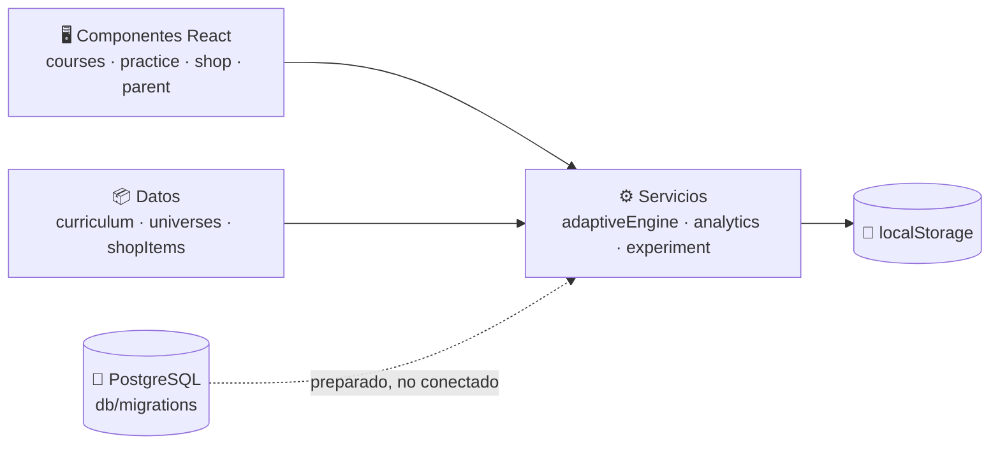

<div align="center">

# 🌍 Mi Mundo Aprende

**Practica tus cursos en un mundo hecho para ti.**
Un reforzador gamificado para niños de 3.° a 5.° de primaria, con foco en matemática, universos temáticos, avatar, tienda y reporte para la familia.

[](https://mi-mundo-aprende-two.vercel.app)


**[Probar la demo](https://mi-mundo-aprende-two.vercel.app)** · [Funciones](#-funciones) · [Arquitectura](#-arquitectura) · [Empezar](#-empezar) · [Estado](#-estado-del-proyecto)

</div>

---

## 🎯 ¿Qué es?

Mi Mundo Aprende convierte la práctica escolar, con foco en matemática, en una aventura. El niño elige **su universo** (fútbol, guerreros, bloques, dinosaurios…), y los enunciados, el avatar, los colores y las recompensas se adaptan a lo que le gusta. La matemática no cambia: solo cambia el envoltorio.

> Proyecto del curso **Proyectos Interdisciplinarios 3 · UTEC** (6.° ciclo).

| 👧 Para el niño | 👨‍👩‍👧 Para la familia |
| :-- | :-- |
| Misiones cortas con pistas, combo y celebraciones | Reporte con la práctica real: acierto por habilidad y actividad de 7 días |
| Avatar por capas y tienda con monedas ganadas | Seguimiento de racha y tiempo de práctica |
| Universo temático a elección | Modelo de suscripción simulado (*Fake Door*) |

## ✨ Funciones

- 🪐 **7 universos temáticos**: Cosmos, Cancha, Selva, Guardianes Ki, Valle Jurásico, Escenario Pop y Noche Rosa.
- 🧠 **Motor adaptativo**: ajusta la dificultad según la racha por habilidad (`src/services/adaptiveEngine.ts`).
- 🧑‍🎤 **Avatar por capas y tienda**: piezas SVG que se equipan y se compran con monedas.
- 🎨 **Estudio de personalización**: el niño arma su mundo.
- 💡 **Pistas, combo y subida de nivel**: retroalimentación inmediata en cada pregunta.
- 📊 **Reporte para la familia**: acierto por habilidad y actividad de los últimos 7 días, con datos reales de práctica.
- 🛡️ **Consentimiento de un adulto**: obligatorio antes de abrir un perfil, con fecha registrada y opción de retirarlo (borra los datos locales).
- 🧪 **Modo experimento**: compara la versión genérica contra la temática (A/B) y mide una *Fake Door* de suscripción.
- 💾 **Sin servidor**: todo vive en `localStorage`; no hay cuentas ni datos en la nube.

## 📚 Contenido

La ruta de práctica cubre **3.° a 5.° grado**. Un curso se publica solo si tiene los tres grados con teoría y preguntas; los demás salen como **Próximamente**.

| Curso | Estado |
| :-- | :-- |
| Aritmética (8 temas) | ✅ Publicado |
| Razonamiento Verbal | ✅ Publicado |
| Lenguaje | ✅ Publicado |
| Historia del Perú | ✅ Publicado |
| Educación Cívica | ✅ Publicado |
| Biología | ✅ Publicado |
| Geometría, Razonamiento Matemático | ⏳ Próximamente (solo 3.° y 4.°, sin teoría) |
| Álgebra, Literatura, Física, Geografía | ⏳ Próximamente |

El problema y el experimento A/B se centran en Matemática (Aritmética); las demás áreas reutilizan el mismo mecanismo de universos.

> ⚠️ El contenido es material de trabajo basado en el temario de admisión y **está pendiente de validación docente** (RF-09). Las variantes narrativas generadas con IA quedan marcadas como `PENDING_TEACHER_REVIEW`.

## 🏗️ Arquitectura



```text
src/
├── components/
│   ├── avatar/       # Avatar por capas
│   ├── courses/      # Mapa de cursos, detalle y lección
│   ├── customize/    # Estudio de personalización
│   ├── experiment/   # Modo A/B y Fake Door
│   ├── parent/       # Reporte familiar y modal de suscripción
│   ├── practice/     # Pregunta, pistas, combo, nivel y celebración
│   └── shop/         # Tienda
├── data/             # Currículo, universos, tienda, experimento
├── services/         # Motor adaptativo, analítica, experimento
└── types/            # Modelo de dominio
db/                   # Migración y semillas de PostgreSQL (aún sin conectar)
scripts/              # Generador de SVG y de variantes narrativas
public/assets/avatar/ # Piezas SVG del avatar
```

## 🚀 Empezar

Requisitos: **Node.js 18+**.

```bash
git clone git@github.com:patrickmedina-ds/Mi-mundo-Aprende---Proyectos-Interdisciplinarios.git
cd Mi-mundo-Aprende---Proyectos-Interdisciplinarios
npm install
npm run dev        # http://localhost:5173
```

| Comando | Qué hace |
| :-- | :-- |
| `npm run dev` | Servidor de desarrollo con recarga en caliente |
| `npm run build` | Compila para producción en `dist/` |
| `npm run preview` | Sirve la compilación localmente |

La app web **no necesita variables de entorno**. Solo el script `scripts/generate_narrative_variants.py` usa `.env.local`; parte de [`.env.example`](.env.example).

## ☁️ Despliegue

El proyecto se publica en **Vercel** como sitio estático de Vite (`vercel.json`). El `.vercelignore` sube solo lo necesario para compilar.

```bash
vercel deploy --prod
```

## 🧭 Estado del proyecto

| Área | Estado |
| :-- | :-- |
| Práctica, avatar, tienda, panel familiar (con datos reales de práctica) | ✅ Funcional |
| Modo experimento (A/B y *Fake Door*) | ✅ Funcional con datos locales |
| Persistencia | 🟡 Solo `localStorage` |
| Base de datos en la nube | ⏳ Esquema listo, sin conectar |
| Validación docente del contenido | ⏳ Pendiente (RF-09) |
| Consentimiento de un adulto (obligatorio, con retiro) | ✅ Funcional · texto legal pendiente de revisión |
| Pasarela de pago real | ❌ Fuera de alcance (solo simulación) |

---

<div align="center">

Hecho con 💜 por el equipo de PI3 · UTEC

</div>
